<div align="center">

# 🎬 NetflixxClone

**A Netflix-inspired streaming catalog built with HTML, CSS, and vanilla JavaScript.**

[](https://reebal-0.github.io/netflixxlone/)


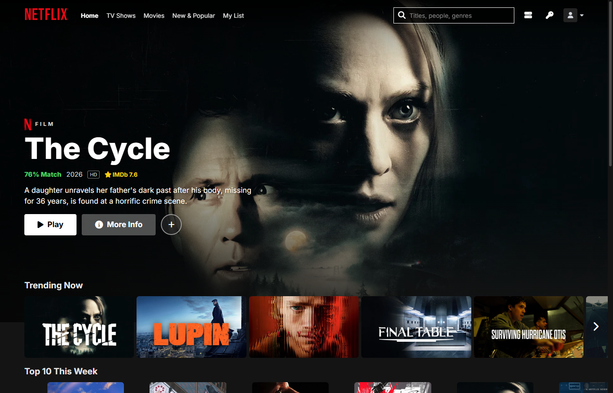

</div>

---

## ✨ Features

- Featured title, trending and top 10 shelves, and movie and TV categories
- Live TMDb catalog, multi-title search, title details, cast, genres, and episode guides
- Full-screen episode player with season picker, episode drawer, navigation controls, and server selection
- Continue watching and recently browsed shelves saved in the browser
- Guest profile, profile avatar choices, sign-in and sign-up screens, and custom lists
- Built-in TMDb fallback data and optional personal API key

## 📸 Screenshots

The full homepage is available in [full-site.png](assets/full-site.png). Focused screenshots cover each main view:

| View | Screenshot |
| --- | --- |
| Homepage |  |
| Movies and TV browse | 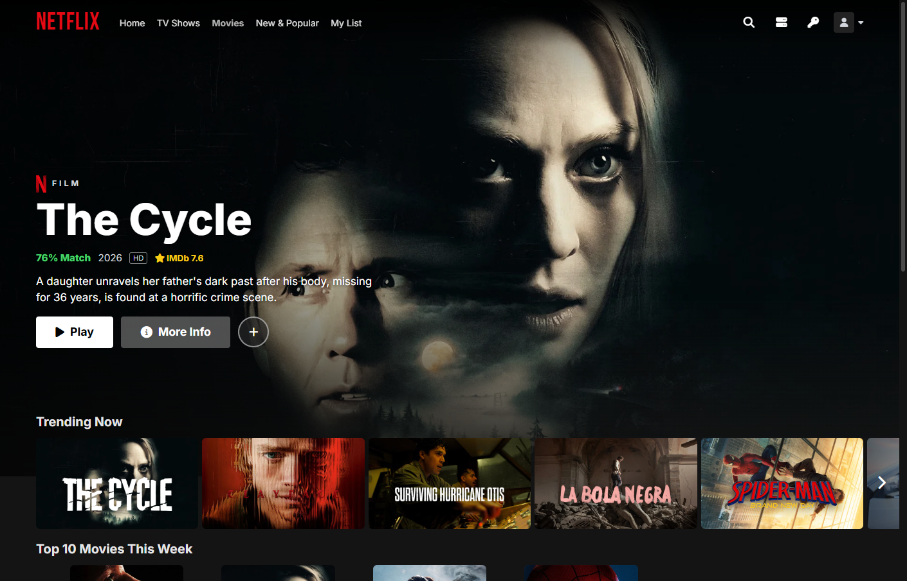 |
| Live search results | 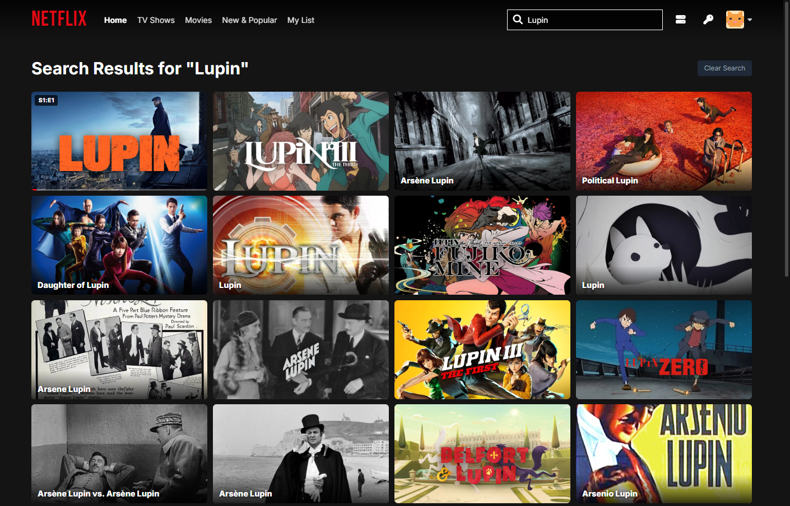 |
| Movie details | 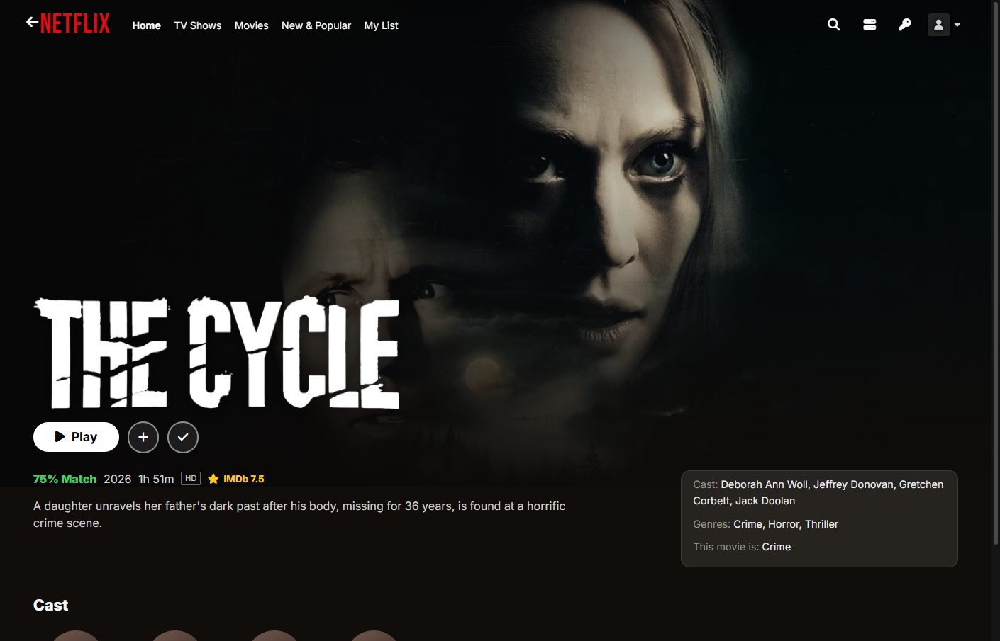 |
| TV details and seasons | 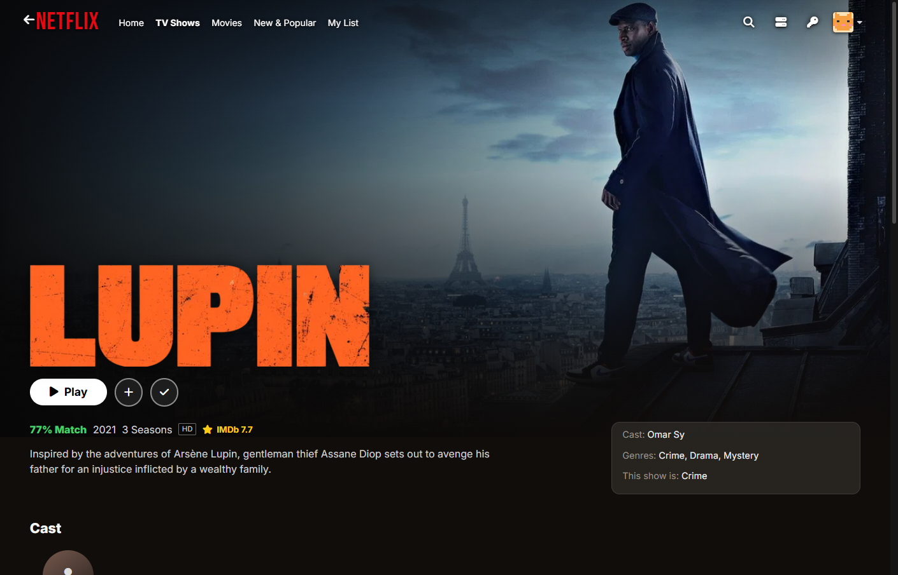 |
| Episode player |  |
| Episode list | 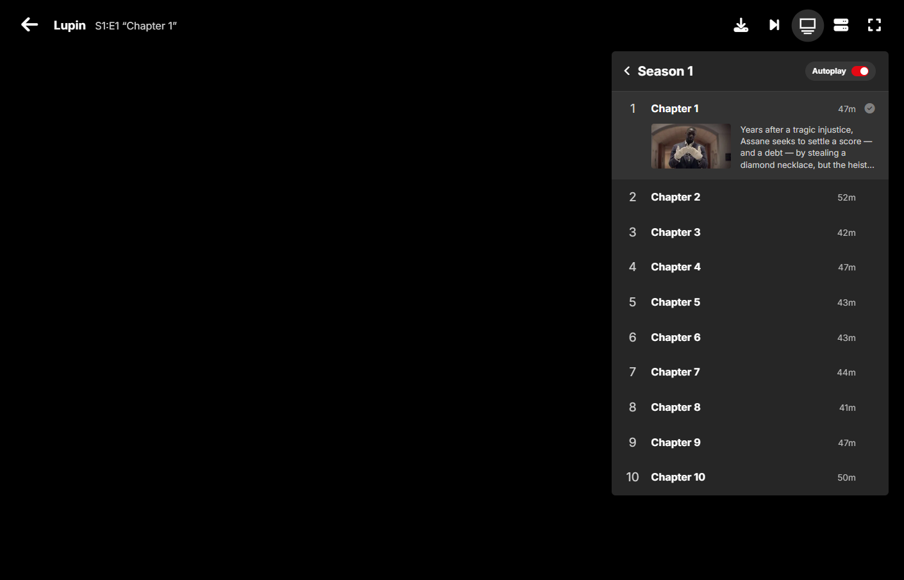 |
| Video server settings | 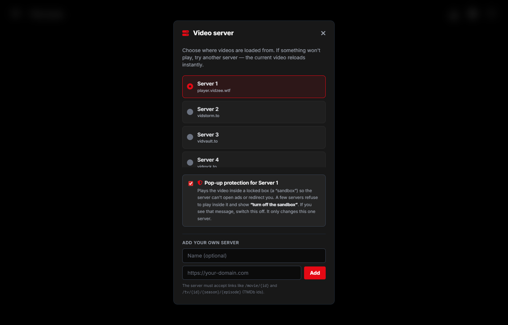 |
| TMDb API configuration | 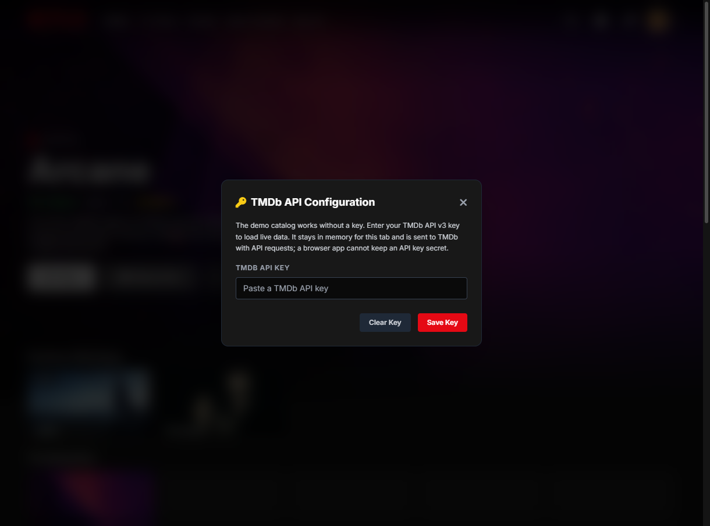 |
| Sign in and sign up | 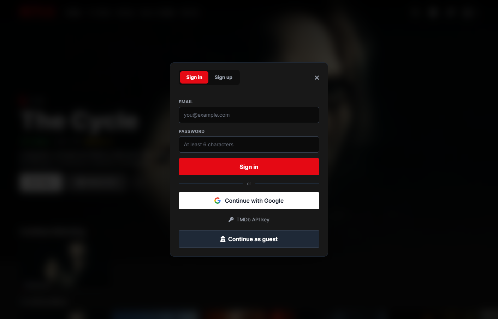 |
| Guest profile | 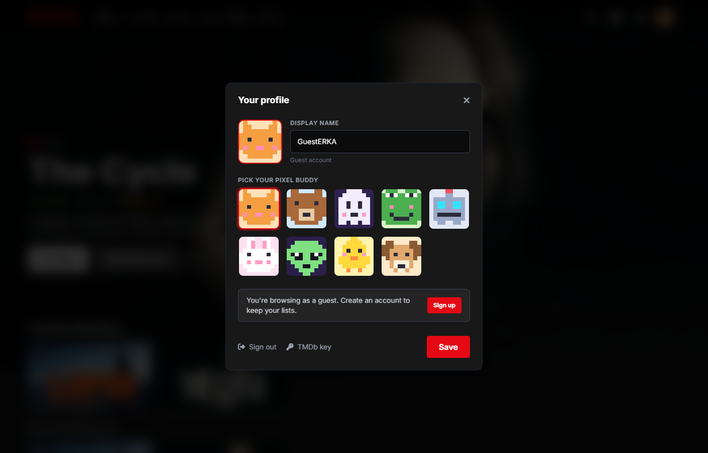 |
| Save to list | 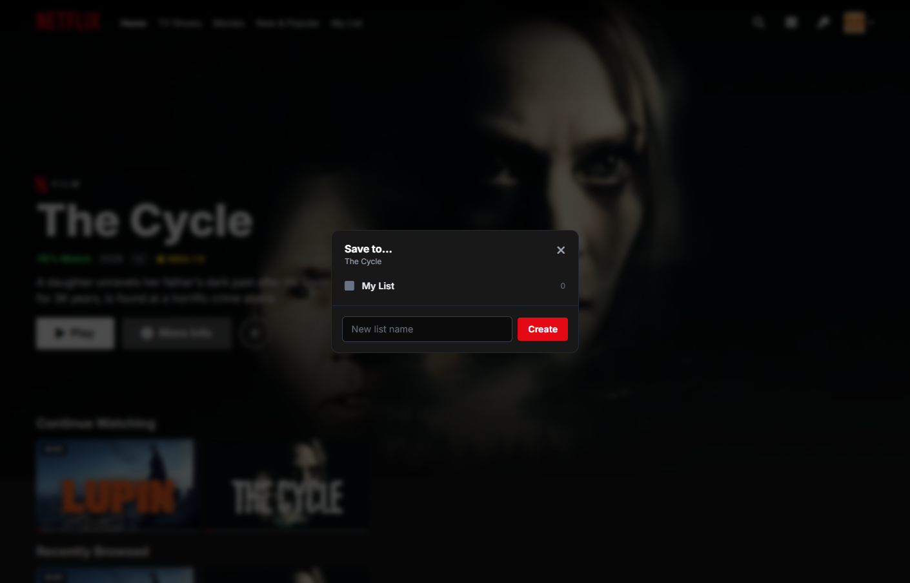 |
| My Lists | 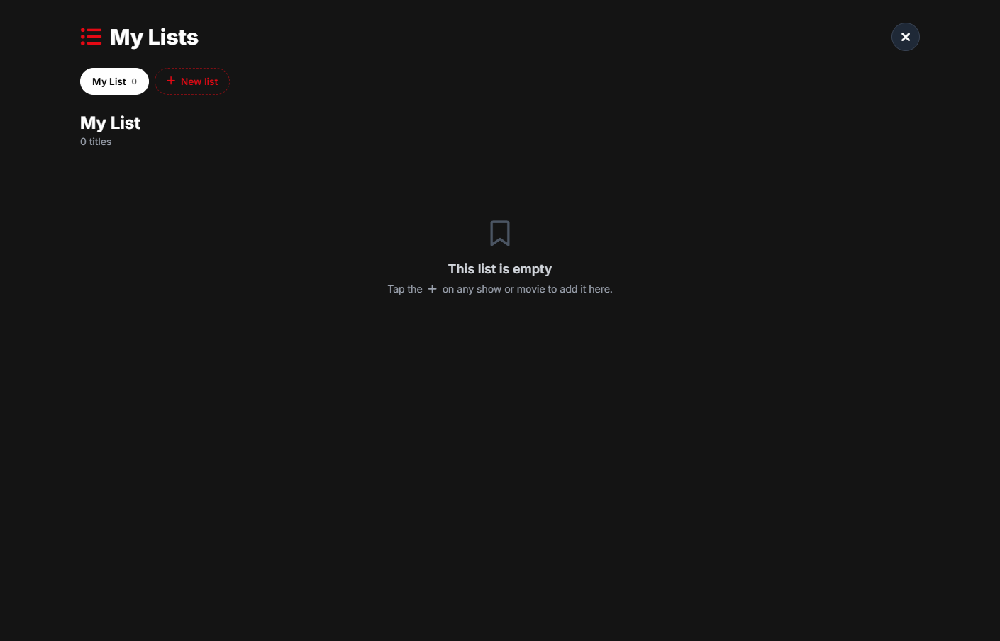 |

## 🚀 Run locally

No build step is required. Clone the repository and open `index.html` in a browser, or use VS Code Live Server:

```bash
git clone https://github.com/reebal-0/netflixxlone.git
cd netflixxlone
```

### Use your own TMDb API key

1. Create a free account at [themoviedb.org](https://www.themoviedb.org/) and request an API key.
2. Open **API Config** in the app, enter your TMDb API v3 key, and select **Save Key**.
3. Select **Save Key** to keep it in this browser across reloads. The field is masked when you reopen API Config; select **Clear Key** to remove it.

To use the built-in public demo key instead, enter `netflix` in API Config and select **Save Key**, or type it into the search box. Both shortcuts save the demo key in this browser and load live TMDb data.

## 🔐 Security notes

- The `netflix` shortcut activates a shared public demo key embedded in the frontend. Anyone can inspect or reuse it, and it may be revoked or rate-limited. It is not a private credential.
- Keys entered in API Config are masked and saved in this browser's local storage so they survive reloads. Since this is a static browser app, saved keys can be read by browser scripts and developer tools and are sent to TMDb. Use a server-side proxy for production; do not save a private key in frontend code.
- Firebase web configuration values are public identifiers, not private credentials. Protect the Firebase project with restrictive Firestore rules, authorized domains, API-key restrictions, and App Check before enabling public access. Never put service-account credentials in this repository.
- Previously published TMDb keys should be revoked in TMDb and replaced, since deleting a key from the current source does not remove it from old commits or published copies.

## 🗂️ Project structure

```text
netflixxlone/
├── index.html          # Page structure and dialogs
├── style.css           # Layout, cards, and player styling
├── app.js              # Catalog, search, lists, profiles, and player behavior
└── assets/             # App icons and README screenshots
```

## ⚠️ Disclaimer

This is a learning project and is not affiliated with, endorsed by, or connected to Netflix. Movie and TV metadata and artwork come from [TMDb](https://www.themoviedb.org/); this product uses the TMDb API but is not endorsed or certified by TMDb. This repository does not host video content.

## 📄 License

Released under the [MIT License](LICENSE).

---

<div align="center">
Made by <a href="https://github.com/reebal-0">reebal-0</a> · If you like it, drop a ⭐
</div>
